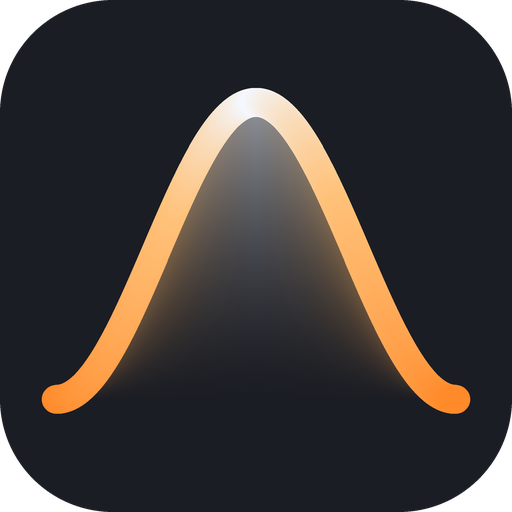
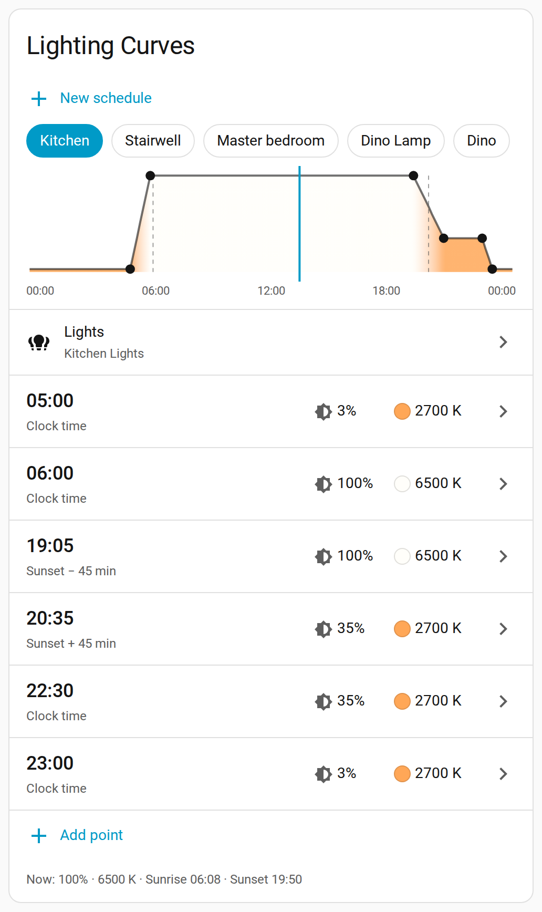
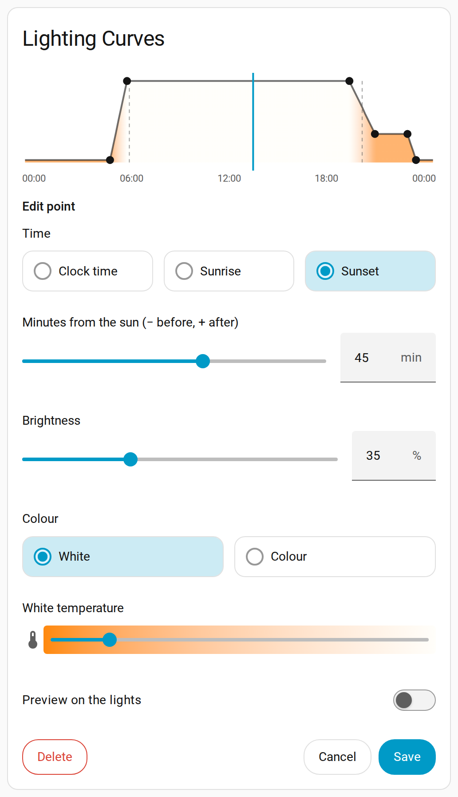

  

# Lighting Curves

A Home Assistant integration that sets your lights' brightness and colour by the time of day. You draw
the day as a curve: warm and dim in the early morning, bright white during the day, warm again in the
evening. Lights follow the curve while they are on, and turn on at the right setting.

## Features

- **Curves made of points.** A point is a time plus a light setting. The light fades in a straight line
  from one point to the next, and the day loops round at midnight.
- **Clock or sun times.** A point can be at a clock time (`06:00`) or relative to sunrise or sunset
  (`sunset-45`). A sun point never moves past the clock points on each side of it, so a late summer
  sunset cannot push an evening point past a fixed 22:00.
- **White or colour.** Each point has a white temperature in kelvin or an RGB colour.
- **No flash at turn-on.** A light that turns on (from a switch, motion sensor, voice, anything) comes on
  at the curve's setting straight away.
- **Manual changes win.** If you change a light by hand, the curve leaves it alone until it turns off and
  on again, or after a timeout you choose.
- **Curve Active switches.** Pause or resume each light from a dashboard or automation.
- **A dashboard card** with a day graph, the point list, a light picker and a live preview on the lights.
- **Actions for automations and agents** to create schedules and set points and lights. See
  [docs/api.md](docs/api.md).

## Install

Requires Home Assistant 2026.10 or later.

1. Add this repository as a custom repository, type **Integration**, in HACS or in the Home Assistant
   Marketplace (2026.11 and later): `https://github.com/dorematt/lighting-curves`.
2. Install **Lighting Curves** and restart Home Assistant.

Manual install: copy `custom_components/lighting_curves` into `/config/custom_components/` and restart.

## Set up your first schedule

1. Go to **Settings → Devices & services → Add integration → Lighting Curves**. Give the schedule a name,
   for example the room. It starts with a default day curve.
2. Select **Configure** on the new schedule and choose its lights.
3. Add the **Lighting Curves** card to a dashboard (search for it in the card picker). No resource setup
   is needed: the integration loads the card.
4. On the card, select a point to change it, or **Add point**. Tick **Preview on the lights** to see a
   setting live; the lights go back to the curve when you save or cancel, or after 10 minutes.

Add more schedules with **New schedule** on the card. A light belongs to one schedule only: adding it to
one takes it off the other.

## Options

Select **Configure** on a schedule under **Settings → Devices & services → Lighting Curves**.

| Option | Default | What it does |
| --- | --- | --- |
| Lights | none | The lights that follow this schedule. |
| Interval | 90 s | How often lights that are on get the curve's current setting. |
| Transition | 45 s | The fade time for those updates. |
| Initial transition | 1 s | The fade time when a light turns on. |
| Manual control | Pause all | After a manual change, pause brightness and colour, or only what you changed. |
| Manual control timeout | 0 (off) | Seconds until the curve takes back a light you changed by hand. With 0, it takes it back at the next off/on. Turning Curve Active off holds without a timer, even after a restart; off/on still resumes. |

## Card options

`type: custom:lighting-curves-card`. All of these are also in the card's visual editor.

| Option | Default | What it does |
| --- | --- | --- |
| `title` | Lighting Curves | The card's title. |
| `hide_title` | `false` | Remove the title. |
| `schedule` | all | Show only one schedule (its name or entry ID). |
| `tabs` | `wrap` | How to pick a schedule: `wrap` (rows of tabs), `scroll` (one row) or `dropdown`. |

## What you get

- One device per schedule, with `sensor.<name>_lighting_curve`. Its state is the brightness now (%), and
  the attribute `color_temp_kelvin` or `rgb_color` is the colour. A schedule with no lights still has
  this sensor, for your own automations.
- One **Light name Curve Active** switch per assigned light, on the schedule device. Turn it on to
  resume and apply the curve to an on light; off pauses both brightness and colour until resumed or
  the light cycles off/on. An off light stays off.
- The actions `lighting_curves.create_schedule`, `set_points`, `set_lights` and `get_schedules`.
- Diagnostics: download them from the schedule's menu when you report a problem.

## Upgrade from 0.x (Adaptive Lighting)

Versions before 1.0 drove lights through [Adaptive Lighting](https://github.com/basnijholt/adaptive-lighting).
1.0 drives the lights itself. On the first start, each schedule copies the lights from the Adaptive
Lighting entry it used. Lighting Curves never changes your Adaptive Lighting entries.

**After the upgrade, remove those lights from their Adaptive Lighting entries** (or remove Adaptive
Lighting). If both control the same light, they fight. The log lists each schedule that still shares
lights with Adaptive Lighting.

## Known limits

- Turn-on without a flash hooks into Home Assistant's light service, the same way Adaptive Lighting does.
  This is not a public Home Assistant API. If a Home Assistant update breaks the hook, Lighting Curves
  logs a warning and sets the light just after it turns on instead.
- One light, one schedule. This includes lights inside a light group: do not put a light in one schedule
  directly and in another schedule through a group.
- Lights that only do white show the nearest white for an RGB point.
- A preview lives in memory. If Home Assistant stops during a preview, lights that were on go back to
  the curve when it starts again, but lights that the preview turned on stay on.
- After an update, refresh the browser if the card does not show the change.

## Credits

The turn-on hook and its light-targeting helper are adapted from
[Adaptive Lighting](https://github.com/basnijholt/adaptive-lighting) by Bas Nijholt and its contributors
(Apache-2.0). The files that hold adapted code say so at the top. Earlier versions of Lighting Curves
used Adaptive Lighting for all light control; thank you to that project.

## AI use

This integration was designed by Matt Dorey and written almost entirely by AI coding agents, mainly
Anthropic's Claude models, with OpenAI's GPT models for reviews and parts of the code. A person directs
the work, tests it on a real Home Assistant, and decides what ships. Report anything wrong in the
[issues](https://github.com/dorematt/lighting-curves/issues).

## Development

See [docs/development.md](docs/development.md).

## Licence

[Apache-2.0](LICENSE).
